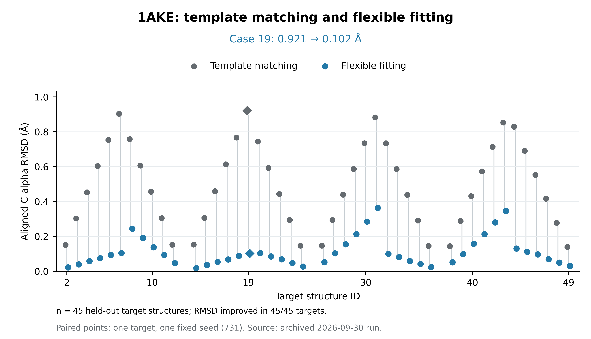
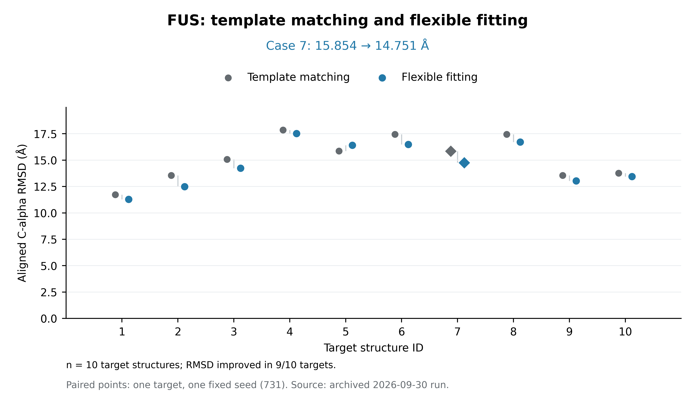

# LPEM-MDFF：已运行的 1AKE / FUS 示例

本目录提供图像驱动、几何正则的静态 Cα 柔性拟合示例，以及 SPONGE/PRIPS 影像偏置 plugin。

## 直接找到代码

| 内容 | 文件 | 用途 |
|---|---|---|
| 1AKE RMSD 图复现 | [examples/1ake/reproduce_rmsd.py](examples/1ake/reproduce_rmsd.py) | 重画 45 个留出目标，标出 case 19 |
| FUS RMSD 图复现 | [examples/fus/reproduce_rmsd.py](examples/fus/reproduce_rmsd.py) | 重画全部 10 个目标，标出 case 7 |
| 两个脚本共享的绘图实现 | [examples/_rmsd.py](examples/_rmsd.py) | 数据校验、目标划分、绘图与导出 |
| 拟合算法与 plugin | [plugin.py](plugin.py) | `benchmark` / `report` / `replay` 与 `Calculate_Force` / `Mdout_Print` |
| 图的实测源数据 | [examples/data/rmsd_records.csv](examples/data/rmsd_records.csv) | 全部 60 个原始目标的模板/柔性 RMSD |
| 来源、种子、哈希和划分 | [examples/data/provenance.json](examples/data/provenance.json) | 保存记录与源代码版本 |
| 原始开发记录 | [DEVELOPMENT.html](DEVELOPMENT.html) | 内嵌摘要、组合图及完整指标定义；下载后可在浏览器打开 |

## 结果预览

RMSD 为预测结构与同一目标结构经过 proper Kabsch 对齐后的对应 Cα 三维均方根距离，单位 Å。横轴为目标结构编号，每对点表示同一目标的模板匹配和柔性拟合结果。

### 1AKE



case 19：模板 13 → 柔性结构，RMSD **0.920656 → 0.101559 Å**。图展示 45 个留出目标；模板内目标 1、13、25、37、50 作为控制保留在源数据中。输入为同一 Gaussian 模型生成的干净单视角投影，50 个插值构象之间具有相关性。

### FUS



case 7：模板 2 → 柔性结构，RMSD **15.854187 → 14.751323 Å**。图保留全部 10 个目标，其中 case 5 的结构误差增大。每组使用其他 9 个结构作为候选库；108 张图用于结构拟合，108 张图用于 pose 配准后的影像评价。原始像素尺度 3 Å/像素属于校准估计，结构结论以该条件及 Gaussian 成像近似为边界。

## 在 CPU 上复现这两张图

准备 Git、Python 3.11 及其 `venv` / `ensurepip` 组件。Ubuntu/Debian 的系统 Python 可通过 `sudo apt-get install python3-venv` 准备 venv 组件。以下 Linux/macOS 命令从下载 `develop` 到核验两张结果图，可依次复制到终端执行：

```bash
git clone --branch develop --single-branch https://github.com/NiuYiHao/SPONGE.git
cd SPONGE
python3 -I -m venv .venv
source .venv/bin/activate
python -I -m pip --isolated install --index-url https://pypi.org/simple -r plugins/image_cc_bias/examples/requirements.txt
python -I -m pip check
python -I plugins/image_cc_bias/examples/1ake/reproduce_rmsd.py --out outputs/1ake
python -I plugins/image_cc_bias/examples/fus/reproduce_rmsd.py --out outputs/fus
python -I plugins/image_cc_bias/examples/verify_rmsd.py --out-root outputs
```

已核验环境为 Python 3.11，依赖版本固定在 [requirements.txt](examples/requirements.txt)。`python -I` 使用隔离模式，`pip --isolated` 使用独立 pip 设置，并显式从 PyPI 安装绘图依赖。`pip check` 应输出 `No broken requirements found.`。

输出分别为 `outputs/1ake/1ake_rmsd.{png,svg,pdf,csv,json}` 和 `outputs/fus/fus_rmsd.{png,svg,pdf,csv,json}`。CSV 保留逐目标数值，JSON 给出案例数值、均值、改善数量和源数据哈希。脚本读取随仓库保存的实测记录，重新生成结果图；这一步的验证范围为数据与绘图复现。

[verify_rmsd.py](examples/verify_rmsd.py) 独立检查输出格式、CSV 的每个目标、JSON 数值和源数据哈希，终端应显示 `PASS 1AKE`、`PASS FUS`；完整核验记录保存到 `outputs/verification.json`。

| 预期结果 | 1AKE | FUS |
|---|---:|---:|
| 绘图目标数 | 45 | 10 |
| 标出的案例 | 19 | 7 |
| 案例模板 RMSD / Å | 0.920656 | 15.854187 |
| 案例柔性 RMSD / Å | 0.101559 | 14.751323 |
| 模板 RMSD 均值 / Å | 0.490370 | 15.212447 |
| 柔性 RMSD 均值 / Å | 0.108925 | 14.637319 |

记录来自 2026-09-30 的 plugin 运行，seed=731；脚本先校验源 CSV 的 SHA256，再按冻结划分选择 45+10 个目标。数据逐值提取自 `DEVELOPMENT.html` 内的 `lpem-replay` 摘要，原始记录与源 plugin 的 SHA256 见 provenance。这里沿用该次运行保存的数值；2026-10-09 的六案例双精度重算另有独立记录。

## 从 PDB / PNG 重新运行拟合

使用 CUDA PyTorch、NumPy 与 Pillow。已运行环境：Python 3.11、PyTorch 2.7.0+cu126、RTX 4060 Ti。将命令中的 `/path/to/` 替换为自己的数据位置：

```bash
python plugins/image_cc_bias/plugin.py --ake-root /path/to/1ake/pdbs \
  benchmark --system 1AKE --targets 19 --out outputs/refit/runs/ake_single_view_v1
python plugins/image_cc_bias/plugin.py --fus-root /path/to/FUS-simulateddata \
  benchmark --system FUS --targets 7 --out outputs/refit/runs/fus_supplied_graph_v2
```

`benchmark` 保存 `config.json`、`summary.json`、`baseline.pdb`、`flexible.pdb`、`result.npz`、`trace.json` 和逐影像分数。上面的两个命令给出单案例入口；单案例结果可直接查看其 `summary.json` 和 PDB。

完整 50+10 目标的拟合和原始案例/统计组合图使用下面的完整布局，`report` 会对保存坐标和投影做独立核验：

```bash
python plugins/image_cc_bias/plugin.py --ake-root /path/to/1ake/pdbs \
  benchmark --system 1AKE --out outputs/full/runs/ake_single_view_v1
python plugins/image_cc_bias/plugin.py --fus-root /path/to/FUS-simulateddata \
  benchmark --system FUS --out outputs/full/runs/fus_supplied_graph_v2
python plugins/image_cc_bias/plugin.py \
  report --workspace outputs/full --out outputs/full/figures
```

数据布局：

- 1AKE：`--ake-root` 指向含 `1akeA_1.pdb` 至 `1akeA_50.pdb` 的目录。模板库固定为 1、13、25、37、50。
- FUS：`--fus-root` 下含 `1/` 至 `10/`，每个目录 216 张 PNG；代表结构位于 `clustering_k5_k10_k30/k10/cluster_representatives_k10_allatom/cluster_{i}_frame_*.pdb`。

默认拟合参数：seed=731；每模板 1024 个旋转候选，100 步 pose 精修，500 步模板组合优化；1AKE 残基形变 300 步，FUS 16 个接触图模式形变 500 步。详细成像参数和预算见原始开发记录。

## SPONGE plugin 的位置与接口

入口为 **[plugin.py](plugin.py)**。PRIPS 配置 `py` 指向这个文件，环境变量 `LPEM_RUN` 指向包含 `input.npz` 和 `settings.json` 的运行目录。

- `Calculate_Force`：解周期边界、对齐 BB、周期更新 pose，将影像势与结构约束势的梯度累加到 `Sponge.dd.frc`。
- `Mdout_Print`：输出影像 CC。
- 坐标与平移：Å；势能：kcal/mol；力：kcal/mol/Å。

RMSD 示例对应静态 Cα 拟合输出。SPONGE 短程积分检查对应偏置力接口与积分行为，两类验证各自保留结果和评价范围。

图形核验记录见 [examples/QA.md](examples/QA.md)。
